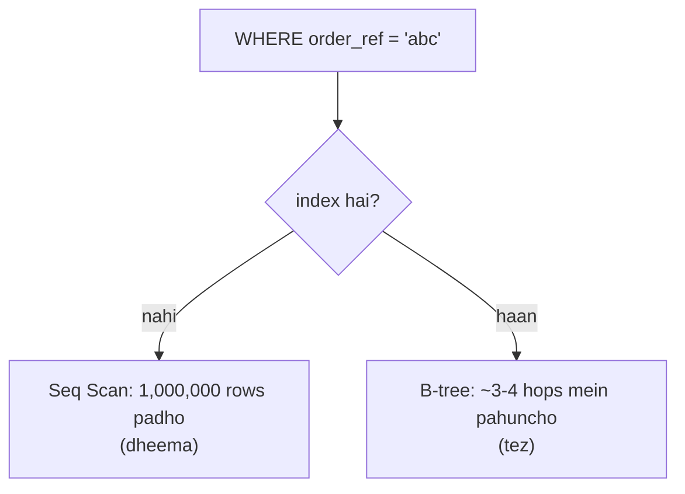
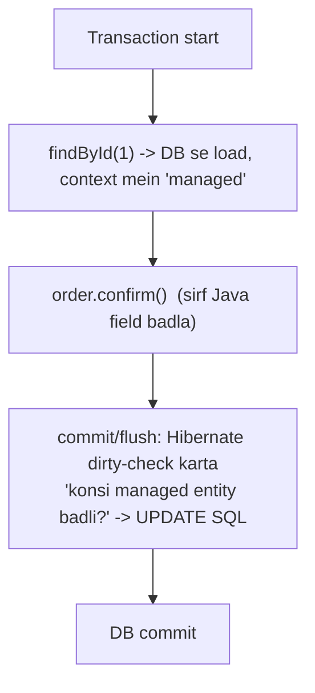
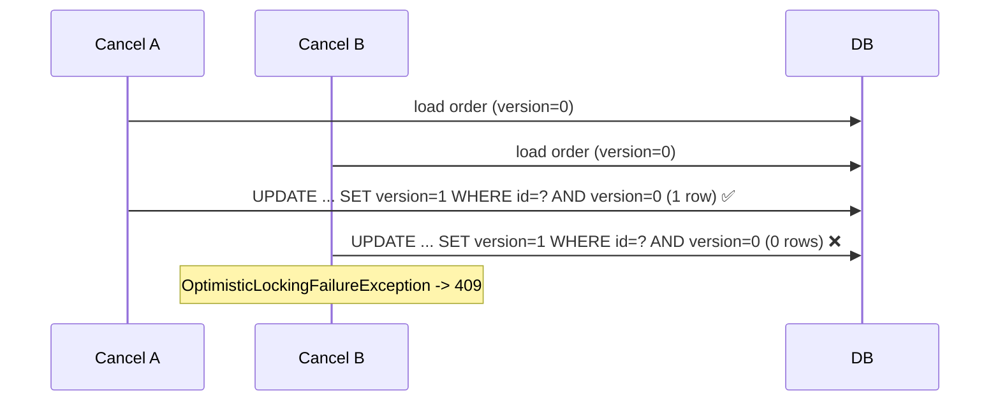
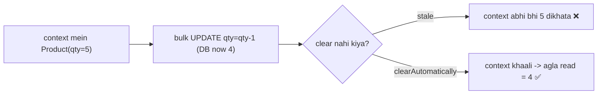

# Indexing + Hibernate/JPA — ek hi jagah (notes + diagrams + tagde labs)

> **Maqsad:** revise karne baitho to **sirf yahi** kaafi ho. Har topic: **kya → kyu → kaise → diagram → is project mein kahan (`file`) → lab (haath se karo)**. Sab easy Hinglish. Saare examples **asli ShopFlow code** se hain, banaye hue nahi.
>
> Related: concepts ka overview [`EASY-NOTES.md`](EASY-NOTES.md) · flows ke diagrams [`VISUAL-FLOWS.md`](VISUAL-FLOWS.md) · Java/Spring interview Q&A [`interview-notes/02-java-spring-boot.md`](interview-notes/02-java-spring-boot.md).

## Lab setup (ek baar)
```bash
make up                      # poora stack (postgres, kafka, ... )
# Postgres ke andar jao (superuser):
docker compose -f shopflow/docker-compose.yml exec postgres psql -U postgres -d orders
# databases: orders, inventory, payments, notifications  (user = db-naam, e.g. -U orders -d orders)
```
psql mein useful:
```sql
\d orders              -- table + saare indexes dikhao
\di                    -- is db ke saare indexes
\timing on             -- har query ka time
EXPLAIN (ANALYZE, BUFFERS) <query>;   -- asli plan + time + pages
```

## Fehrist
1. [Index kya hai, kyu (B-tree)](#1)
2. [Index ke types + kab (is repo ke saath)](#2)
3. [ShopFlow ke saare indexes — ek table](#3)
4. [LAB-A: seq scan vs index scan (EXPLAIN)](#4)
5. [LAB-B: composite index ka column order](#5)
6. [LAB-C: covering / index-only scan](#6)
7. [LAB-D: partial index (outbox)](#7)
8. [Index kab NUKSAAN karta hai](#8)
9. [Hibernate: persistence context, dirty checking, flush](#9)
10. [LAB-E: optimistic lock (`@Version`) race](#10)
11. [LAB-F: pessimistic lock + `SKIP LOCKED` (outbox)](#11)
12. [LAB-G: atomic `@Modifying` update (oversell) + flush/clear](#12)
13. [`@Transactional` ke 3 jaal (self-invoke, open-in-view, propagation)](#13)
14. [N+1 + is project ne kaise bachaya](#14)
15. [ddl-auto validate + Flyway, identity, enum](#15)
16. [Rapid-fire revision (interview)](#16)

---

## 1. Index kya hai, kyu <a id="1"></a>

**Kya:** table ki ek alag, sorted copy (sirf chunne hue columns + row pointer). Jaise book ke end ka index — poori book padhe bina page number mil jaata hai.

**Kyu:** bina index ke DB ko **poori table scan** karni padti hai (Seq Scan) — O(n). Index B-tree hota hai → O(log n) mein row mil jaati hai.



**B-tree (kaise):** balanced tree, har node mein sorted keys. Root → branch → leaf; leaf pe actual key + row-pointer (ctid). Isliye `=`, `<`, `>`, `BETWEEN`, `ORDER BY`, prefix `LIKE 'abc%'` sab fast — **sorted** jo hai.

```
            [ m ]                 root
           /     \
     [ d  h ]   [ q  u ]          branch (sorted keys)
     / | \        ...
 [a,b,c][e,f,g]...               leaf -> row pointers
```

**Trade-off:** har INSERT/UPDATE/DELETE pe index bhi update hota hai (B-tree rebalance) + disk space. Isliye **har column pe index mat lagao** — sirf jahan padha/filter/sort hota hai.

**Is project mein:** har `findByX`, `WHERE`, `ORDER BY`, reconciler ka `status + updatedAt` — in sab ke peechhe ek socha-samjha index hai (section 3).

---

## 2. Index ke types + kab <a id="2"></a>

| Type | Kab | ShopFlow example |
|---|---|---|
| **Primary key** (unique, clustered-ish) | har table ki pehchaan | `orders.id`, `payment.event_id` (uuid) |
| **Unique index** | duplicate rokna + fast lookup | `orders.order_ref`, `orders.idempotency_key`, `product.sku`, `reservation.order_ref` |
| **Composite (multi-column)** | ek saath filter+sort, ya do columns pe filter | `orders (customer_id, created_at desc)` |
| **Covering** (index mein saare needed columns) | index-only scan, table touch na ho | niche LAB-C |
| **Partial** (`WHERE ...`) | rows ka chhota subset hi chahiye | `outbox WHERE published_at IS NULL` (Postgres; H2 nahi) |
| **Foreign-key index** | FK join/lookup + delete fast | `reservation.sku -> product.sku` |

**Rule of thumb (kaise decide karo):** jo column `WHERE`/`JOIN`/`ORDER BY` mein aata hai aur **selective** hai (kam rows match karte hain) → index. Boolean/2-value column pe akela index bekaar (half table match).

---

## 3. ShopFlow ke saare indexes — ek table <a id="3"></a>

| Table | Index | Kis query ke liye | Kahan (`file`) |
|---|---|---|---|
| `orders` | PK `id` | `findById` | `V1__create_orders.sql` |
| `orders` | unique `order_ref` | `findByOrderRef` (saga/payment events) | V1 |
| `orders` | unique `idempotency_key` | `findByIdempotencyKey` (retry dedupe) | V1 |
| `orders` | `idx_orders_created_at (created_at desc)` | list "newest first" | V1 |
| `orders` | `idx_orders_customer_created (customer_id, created_at desc)` | `findByCustomerId(... Pageable desc)` — "my orders" | `V3__order_owner.sql` |
| `orders` | `idx_orders_status_updated (status, updated_at)` | reconciler: `findTop100ByStatusInAndUpdatedAtBefore` | V3 |
| `product` | unique `sku` | `findBySku`, `decrementStock WHERE sku=` | inventory `V1__create_tables.sql` |
| `reservation` | unique `order_ref` | `findByOrderRef` + **idempotency** | inventory V1 |
| `payment` | PK `event_id` (uuid) | charge idempotency (`existsById`) | payment `V1__payment.sql` |
| `payment` | unique `order_ref` | `findByOrderRef` (refund) | payment V1 |
| `outbox_event` | `idx_outbox_pending (published_at, created_at)` | relay: "oldest unpublished first" | `V2__outbox.sql` |
| `processed_event` | PK `event_id` (uuid) | consumer dedupe (`existsById`) | V5 |

> **Note (asli design decision):** `idx_outbox_pending (published_at, created_at)` — ek **partial index** `... WHERE published_at IS NULL` chhota aur tez hota (relay sirf unpublished dhoondhta hai), par **H2 (tests) partial index parse nahi karta**, isliye portable composite index rakha. Ye `SELF-WALK.md` Walk 3 ka asli sabak hai: *test DB ≠ prod DB.*

---

## 4. LAB-A: seq scan vs index scan <a id="4"></a>

**Task:** dekho ki index se query plan kaise badalta hai.
**Why:** "index laga diya" kaafi nahi — **EXPLAIN se prove karo** ki query use bhi kar rahi hai.

**Diagram:**
```
EXPLAIN ANALYZE SELECT ... WHERE customer_id = 'alice'
   bina index:  Seq Scan on orders   (rows=1,000,000)   cost high
   index ke baad: Index Scan using idx_orders_customer_created   cost low
```

**Steps (psql, `-d orders`):**
```sql
-- 1. thoda data bharo (1 lakh rows, alag customers)
INSERT INTO orders (order_ref, customer_id, sku, quantity, status, created_at, updated_at, version)
SELECT gen_random_uuid()::text, 'cust-'||(i%500), 'PS5-SLIM', 1, 'CONFIRMED', now(), now(), 0
FROM generate_series(1,100000) i;
ANALYZE orders;                        -- planner ko stats do

-- 2. index ke SAATH (ye already V3 se bana hai):
EXPLAIN (ANALYZE, BUFFERS)
SELECT * FROM orders WHERE customer_id = 'cust-7' ORDER BY created_at DESC LIMIT 20;
--   -> "Index Scan using idx_orders_customer_created"  (fast, kam buffers)

-- 3. ab index hata ke dekho:
DROP INDEX idx_orders_customer_created;
EXPLAIN (ANALYZE, BUFFERS)
SELECT * FROM orders WHERE customer_id = 'cust-7' ORDER BY created_at DESC LIMIT 20;
--   -> "Seq Scan on orders" + "Sort"  (slow, poori table padhi)

-- 4. wapas banao (warna app slow):
CREATE INDEX idx_orders_customer_created ON orders (customer_id, created_at DESC);
```
**Expected:** step 2 `Index Scan`, step 3 `Seq Scan` + `Sort`, time/buffers kai guna zyada.
**Common mistakes:** `ANALYZE` na karna (planner purane stats pe galat chunta); chhote table pe test karna (Postgres chhoti table pe jaanbujh ke Seq Scan karta — wo sasta hai, isliye 1 lakh rows daale).

---

## 5. LAB-B: composite index ka column order <a id="5"></a>

**Task:** samjho `(customer_id, created_at)` aur `(created_at, customer_id)` mein farak kyu hai.
**Why:** composite index **leftmost-prefix** rule pe chalta hai — galat order = index bekaar.

**Diagram (leftmost prefix):**
```
INDEX (customer_id, created_at)   -- pehle customer_id se sorted, phir created_at
  use hota hai:  WHERE customer_id=?                     ✅
                 WHERE customer_id=? ORDER BY created_at  ✅ (sort free!)
                 WHERE customer_id=? AND created_at>?     ✅
  NAHI hota:     WHERE created_at>?   (akela)             ❌ (customer_id skip nahi kar sakte)
```

**Steps:**
```sql
-- "my orders newest first" = customer pe filter + created_at pe sort -> (customer_id, created_at DESC) perfect
EXPLAIN (ANALYZE) SELECT * FROM orders WHERE customer_id='cust-7' ORDER BY created_at DESC LIMIT 20;
-- Index Scan + NO separate "Sort" node  <- kyunki index already us order mein sorted hai

-- agar order ulta hota (created_at, customer_id):
CREATE INDEX idx_test_wrong ON orders (created_at DESC, customer_id);
EXPLAIN (ANALYZE) SELECT * FROM orders WHERE customer_id='cust-7' ORDER BY created_at DESC LIMIT 20;
-- planner ise customer_id filter ke liye theek se use nahi kar paata (created_at leftmost hai)
DROP INDEX idx_test_wrong;
```
**Expected:** sahi order pe "Sort" node gayab (index sorted deta hai) → list endpoint fast.
**Yaad rakho:** **equality columns pehle, range/sort column baad mein.** Isiliye repo mein `(customer_id, created_at)` aur `(status, updated_at)` — dono mein equality (`customer_id`, `status IN`) pehle.

---

## 6. LAB-C: covering / index-only scan <a id="6"></a>

**Task:** dekho jab index mein **saare needed columns** ho to table chhuna hi na pade ("Index Only Scan").
**Why:** fastest read — heap (table) pages touch nahi, sirf index.

**Diagram:**
```
SELECT created_at FROM orders WHERE customer_id='x'
  normal index:  index -> row pointer -> HEAP fetch (extra IO)
  covering idx (customer_id, created_at): sab index mein hi -> "Index Only Scan"  (heap skip)
```
**Steps:**
```sql
EXPLAIN (ANALYZE) SELECT created_at FROM orders WHERE customer_id='cust-7' ORDER BY created_at DESC LIMIT 20;
-- idx_orders_customer_created mein customer_id + created_at dono hain -> "Index Only Scan" mil sakta hai
-- (VACUUM ANALYZE orders;  ke baad visibility map set hota hai, tabhi index-only pura kaam karta)
VACUUM ANALYZE orders;
```
**Expected:** `Index Only Scan` (ya `Heap Fetches: 0` ke paas). Postgres mein `INCLUDE (col)` se bhi covering bana sakte ho bina us col ko key banaye.
**Mistake:** `SELECT *` maangna — tab saare columns heap se chahiye, covering ka fayda khatam.

---

## 7. LAB-D: partial index (outbox) <a id="7"></a>

**Task:** outbox relay ke liye partial index banao aur plan dekho.
**Why:** relay sirf `published_at IS NULL` rows dhoondhta hai (published rows 7 din tak padi rehti hain). Partial index sirf unpublished rows rakhta hai → chhota + tez, aur cleanup ke baad khud shrink.

**Diagram:**
```
outbox_event: 1,000,000 rows (999,990 published, 10 pending)
  full index  (published_at, created_at):  10 lakh entries
  partial idx (created_at) WHERE published_at IS NULL:  sirf 10 entries  <- chhota, garam
```
**Steps (`-d orders` ya `payments`):**
```sql
-- repo mein portable (H2-safe) composite hai. Postgres pe partial behtar:
CREATE INDEX idx_outbox_pending_partial ON outbox_event (created_at) WHERE published_at IS NULL;
EXPLAIN (ANALYZE)
SELECT * FROM outbox_event WHERE published_at IS NULL ORDER BY created_at LIMIT 100;
-- -> partial index use hoga; bahut kam pages
DROP INDEX idx_outbox_pending_partial;   -- repo wala H2-portable hi rakho
```
**Asli trade-off (SELF-WALK Walk 3):** partial index Postgres-only hai; H2 (tests) `WHERE` wale index ko parse nahi karta → tests toot jaate. Isliye repo portable composite rakhta hai; "real fix = Testcontainers (prod-jaisa Postgres test mein)" — STATE §4 open item.

---

## 8. Index kab NUKSAAN karta hai <a id="8"></a>

- **Write-heavy table:** har INSERT/UPDATE pe saare indexes update → slow writes. (outbox bahut likha jaata hai → isliye usme sirf 1 zaroori index.)
- **Low-selectivity column:** `status` mein sirf 6 values; akela `status` index aadhi table laut sakta hai → planner Seq Scan hi chunega. Isliye repo `(status, updated_at)` composite rakhta hai (reconciler ko `status IN (FAILED,PENDING) AND updated_at < grace` chahiye — dono milke selective).
- **Zyada indexes:** space + planner confuse + writes slow. Sirf wahi banao jo koi query sach mein use kare (EXPLAIN se verify).
- **Function pe filter:** `WHERE lower(sku)=...` normal index use nahi karega — expression index chahiye.

---

## 9. Hibernate: persistence context, dirty checking, flush <a id="9"></a>

**Persistence context (1st-level cache):** ek `@Transactional` ke andar, har loaded/saved entity ek "managed" map mein rehti hai. Usi id ko dobara `findById` karo → DB nahi, cache se.



**Dirty checking:** tumne `order.setStatus(...)` kiya, `save()` call kiya ya nahi — farak nahi; **flush pe Hibernate khud UPDATE bhejta** hai agar managed entity badli hai. (Isiliye `Order.confirm()` ke baad explicit save ki zaroorat nahi jab entity managed ho.)

**Flush kab:** transaction commit se pehle; ya query chalане se pehle (taaki query ko latest dikhe); ya `flush()` manually.

**`open-in-view: false` (repo mein):** default Spring `true` rakhta — view/controller tak session khula, lazy fields controller mein load ho jaate (hidden N+1 + DB connection zyada der). Repo ne **`false`** kiya → lazy data **service layer** mein hi load karo, warna `LazyInitializationException`. Ye jaanbujh ke hai (honest failure > hidden slow query). → `application.yml` `spring.jpa.open-in-view: false`.

### 9.1 `save()` = persist ya merge? (assigned @Id ka chhupa SELECT)

`SimpleJpaRepository.save()` decide karta hai: `isNew()` true → `em.persist()` (pura INSERT, 1 query); false → `em.merge()` (pehle `SELECT ... WHERE id=?`, phir INSERT/UPDATE = 2 query — wo SELECT dekhta hai row detached copy ko DB se reconcile karna hai ya nahi).

**Default `isNew()`:** `@Version` null? → new. Warna `@Id` null? → new → persist. Warna (id set) → "purana" → merge.

**Trap:** jin entities ka `@Id` **hum assign** karte hain (UUID `eventId`), id kabhi null nahi → default merge chun leta → har insert pe **bekaar SELECT**. Kafka consumer ki har message, txn ke andar — ek extra round-trip.

**Fix:** insert-only entity ko `Persistable<UUID>` banao, `isNew(){return true;}` → persist → plain INSERT. Safe kyunki ye rows `save()` se update nahi hoti (Payment refund = §9 wala dirty-check `markRefunded()`, `save()` nahi); idempotency guard **PK** hai (duplicate eventId INSERT pe fail), merge ke SELECT pe depend nahi.

| Entity | @Id | save() | Persistable? |
|---|---|---|---|
| `OutboxEvent`, `ProcessedEvent`×2, `Payment` | assigned UUID, insert-only | chahiye INSERT | **haan** (W21/W38) `isNew()=true` |
| `Product`, `Reservation` | `@GeneratedValue IDENTITY` | id null→persist auto | nahi chahiye |
| `Order` | IDENTITY + `@Version`, sach-much UPDATE | merge SAHI | nahi — rehne do |

Diagram: [`VISUAL-FLOWS.md` #14](VISUAL-FLOWS.md#14-save-persist-merge). Story: `SELF-WALK.md` Walk 21 + 38.

---

## 10. LAB-E: optimistic lock (`@Version`) race <a id="10"></a>

**Code (`order/Order.java`):**
```java
@Version
private long version;   // do concurrent updates -> ek jeet-ta, doosra fail
```
**Kya/kyu:** do request ek hi order ko ek saath cancel karein → bina lock ke ek doosre ko overwrite kar de (lost update). `@Version` har UPDATE mein `WHERE version = :old` lagata hai; jo pehle commit kare version badha deta, doosre ka UPDATE **0 rows** → `OptimisticLockingFailureException`.

**Flow:**

**Handling (`common/GlobalExceptionHandler.java`):** `OptimisticLockingFailureException` → **409 "Concurrent modification"** (500 nahi). Test: `OrderServiceApplicationTests` double-cancel → ek 409.
**Lab:** psql se manually dekho —
```sql
SELECT id, version FROM orders LIMIT 1;             -- maan lo id=5, version=0
UPDATE orders SET status='CANCELLED', version=1 WHERE id=5 AND version=0;  -- 1 row (jeeta)
UPDATE orders SET status='CANCELLED', version=1 WHERE id=5 AND version=0;  -- 0 rows (haara) <- yahi exception banta
```
**Mistake:** `@Version` ko manually set karna; ya optimistic-lock exception ko 500 chhod dena (client ke liye normal race hai → 409).

---

## 11. LAB-F: pessimistic lock + `SKIP LOCKED` (outbox) <a id="11"></a>

**Code (`shopflow-outbox/OutboxRepository.java`):**
```java
@Lock(LockModeType.PESSIMISTIC_WRITE)
@QueryHints(@QueryHint(name = "jakarta.persistence.lock.timeout", value = "-2"))
@Query("select e from OutboxEvent e where e.publishedAt is null order by e.createdAt")
List<OutboxEvent> findUnpublished(Pageable pageable);
```
**Kya/kyu:** `-2` = Postgres pe **`FOR UPDATE SKIP LOCKED`**. Kai order-service pods ek saath relay chalate hain; har pod ko **alag** unpublished rows milti hain (jo locked hain wo skip) → ek event do baar publish nahi hota, aur pods ek doosre ka wait nahi karte.

**Diagram:**
```
outbox (pending: r1 r2 r3 r4)
 Pod-A: SELECT ... FOR UPDATE SKIP LOCKED LIMIT 2  -> locks r1,r2
 Pod-B: SELECT ... FOR UPDATE SKIP LOCKED LIMIT 2  -> r1,r2 locked -> skip -> locks r3,r4
 dono parallel publish, zero overlap
```
**Lab (do psql windows kholo, `-d orders`):**
```sql
-- window 1:
BEGIN;
SELECT id FROM outbox_event WHERE published_at IS NULL ORDER BY created_at
  FOR UPDATE SKIP LOCKED LIMIT 2;     -- 2 rows lock kar li, transaction khula chhodo
-- window 2 (turant):
BEGIN;
SELECT id FROM outbox_event WHERE published_at IS NULL ORDER BY created_at
  FOR UPDATE SKIP LOCKED LIMIT 2;     -- window-1 wali 2 skip, agli 2 mili -> NO wait
-- dono: COMMIT;
```
**Compare:** `FOR UPDATE` (bina SKIP LOCKED) hota to window-2 **block** ho jaata jab tak window-1 commit na kare. SKIP LOCKED = no blocking.
**Mistake (SELF-WALK Walk 12):** `@Transactional` ke andar Kafka I/O ko lamba hold karna — lock + DB connection der tak roke rakhta (open item).

---

## 12. LAB-G: atomic `@Modifying` update (oversell) + flush/clear <a id="12"></a>

**Code (`product/ProductRepository.java`):**
```java
@Modifying(clearAutomatically = true, flushAutomatically = true)
@Query("update Product p set p.quantity = p.quantity - :qty where p.sku = :sku and p.quantity >= :qty")
int decrementStock(@Param("sku") String sku, @Param("qty") int qty);   // returns rows updated (0 = no stock)
```
**Kya/kyu:** "read quantity → check → write" ke bajaye **ek atomic UPDATE**. DB row-lock do concurrent orders ko serialize karta, aur `WHERE quantity >= :qty` dobara check karta → **oversell impossible** (details [`VISUAL-FLOWS.md`](VISUAL-FLOWS.md#6-oversell)).

**`flushAutomatically`/`clearAutomatically` kyu (ye interview-trick hai):**
- `flushAutomatically=true`: bulk UPDATE se **pehle** pending changes DB mein flush ho (warna UPDATE purane data pe chale).
- `clearAutomatically=true`: bulk UPDATE **DB mein seedha** chalti hai, persistence-context ko bypass karti → context mein padi `Product` entity ab **stale** (purana quantity). Clear na karo to baad mein wahi stale entity padh loge. Clear context khaali kar deta → agla read fresh DB se.


**Lab:**
```sql
-- oversell test: stock 1, do baar ghatao
UPDATE product SET quantity=1 WHERE sku='PS5-SLIM';
UPDATE product SET quantity=quantity-1 WHERE sku='PS5-SLIM' AND quantity>=1;  -- 1 row (0 ho gaya) ✅
UPDATE product SET quantity=quantity-1 WHERE sku='PS5-SLIM' AND quantity>=1;  -- 0 rows (reject) ✅
SELECT quantity FROM product WHERE sku='PS5-SLIM';   -- 0, kabhi -1 nahi
```
**Mistake:** JPA se entity load karke `setQuantity(q-1)` (read-modify-write) → race condition → oversell. Isliye yahan derived setter nahi, atomic `@Query`.

---

## 13. `@Transactional` ke 3 jaal <a id="13"></a>

**(a) Self-invocation (proxy bypass) — asli repo fix:**
```java
// OrderService.saveWithEvent() @Transactional NAHI hai; TransactionTemplate use karta hai.
// kyunki: usi class ki @Transactional method ko 'this.method()' se call karoge to Spring ka
// proxy bypass ho jaata -> transaction CHALTA HI NAHI -> outbox atomicity toot jaati.
Order saved = transactionTemplate.execute(status -> {
    Order persisted = orderRepository.save(order);
    outbox.publish(...);               // order + event -> EK transaction
    return persisted;
});
```
Diagram:
```
controller -> [Spring proxy] -> bean.methodA()        (proxy ne tx shuru ki ✅)
bean.methodA() -> this.methodB()  (@Transactional)    (proxy BYPASS -> tx nahi ❌)
```
Fix: alag bean mein daalo, ya `TransactionTemplate` (repo ne yahi kiya).

**(b) `open-in-view`** — section 9. Repo `false` → lazy load service mein.

**(c) Propagation / HTTP inside tx:** `placeOrder` **jaanbujh ke** ek bada `@Transactional` nahi — HTTP call (inventory) ke dauraan DB transaction+connection hold karna pool kha jaata. Har step alag save, status batata kitni door pahunche. (`OrderService` ka top comment.)

---

## 14. N+1 + is project ne kaise bachaya <a id="14"></a>

**N+1 kya:** 1 query se N parent laao, phir har parent ke liye 1-1 query (child) → 1 + N queries. Classic Hibernate trap (`@OneToMany` lazy + loop).
```
SELECT * FROM orders;              -- 1 query, 100 orders
-- phir loop: har order ke items:
SELECT * FROM items WHERE order_id=1;  ... x100   -- 100 queries  (N+1!)
```
**Fix (general):** `JOIN FETCH`, `@EntityGraph`, ya batch fetching.

**Is project ne kaise sidestep kiya (design decision):** ShopFlow mein **entities ke beech JPA relations (`@ManyToOne`/`@OneToMany`) hain hi nahi**. Services sirf **IDs/refs** rakhte hain (`order.sku`, `reservation.orderRef`, `payment.orderRef`) — object graph nahi. Cross-service data REST (inventory) ya events (Kafka) se aata hai, JPA lazy-load se nahi. → **N+1 ka mauka hi nahi**, aur services loosely coupled. Ye microservices ka natural fayda hai: ek service ka DB doosre ka object graph nahi khinchta.

---

## 15. ddl-auto validate + Flyway, identity, enum <a id="15"></a>

- **`spring.jpa.hibernate.ddl-auto: validate`** (repo): Hibernate schema **banata nahi**, sirf **check** karta ki entity ↔ table match karti hai. Schema ka maalik **Flyway** (`db/migration/V*.sql`). Prod mein `create`/`update` kabhi mat — data uda sakta / drift. Validate = startup pe fail-fast agar migration aur entity match na karein.
- **`@GeneratedValue(strategy = IDENTITY)`:** DB auto-increment (`generated by default as identity`). Postgres pe theek. (Note: IDENTITY ke saath Hibernate JDBC batch-insert nahi kar paata — high-insert pe `SEQUENCE` better; yahan load kam hai to IDENTITY fine.)
- **`@Enumerated(EnumType.STRING)`:** enum ko **naam** se store (`"CONFIRMED"`), `ORDINAL` (0,1,2) se nahi. Kyu: ordinal mein enum ka order badla to purana data corrupt. STRING readable + safe. (repo: `OrderStatus`, `Reservation.Status`, `Payment.Status`.)
- **uuid PK (`payment.event_id`, `outbox.id`, `processed_event.event_id`):** business/event id hi PK — idempotency free (`existsById(eventId)`), aur distributed-friendly (koi central sequence nahi).

---

## 16. Rapid-fire revision (interview) <a id="16"></a>

- **Index kaise kaam karta?** B-tree, O(log n), sorted; `=`/range/`ORDER BY`/prefix-LIKE fast.
- **Composite index order?** equality columns pehle, range/sort baad; leftmost-prefix rule. Repo: `(customer_id, created_at)`, `(status, updated_at)`.
- **Index kab mat lagao?** write-heavy table, low-selectivity column, `SELECT *` covering ki ummeed.
- **Index use ho raha hai, kaise pata?** `EXPLAIN (ANALYZE, BUFFERS)` → Index Scan vs Seq Scan.
- **Oversell kaise ruka?** atomic `UPDATE ... WHERE quantity>=:qty`, row-lock serialize + re-check.
- **`@Modifying` mein flush/clear kyu?** flush: update se pehle pending changes jaayein; clear: context ki stale entity hata do.
- **Optimistic vs pessimistic lock?** optimistic = `@Version` (`WHERE version=`, loser 409), kam contention; pessimistic = `FOR UPDATE [SKIP LOCKED]`, zyada contention/queue (outbox relay).
- **SKIP LOCKED kyu?** multi-pod relay, har pod alag rows, no blocking, no double-publish.
- **`@Transactional` self-call kyu nahi chalta?** Spring proxy bypass; fix = alag bean / `TransactionTemplate`.
- **`open-in-view: false` kyu?** hidden lazy-load/N+1 aur lambi DB session se bacho; lazy data service mein load karo.
- **`save()` persist ya merge?** `isNew()` true → persist (INSERT); false → merge (SELECT + ...). Assigned `@Id` + no `@Version` → default merge → bekaar SELECT; insert-only pe `Persistable isNew()=true` → plain INSERT. Guard PK hai, merge pe nahi.
- **ddl-auto prod mein?** `validate` (+ Flyway). `create/update` kabhi nahi.
- **N+1 is project mein?** nahi — JPA relations hi nahi, sirf IDs + REST/events.
- **enum store?** `STRING` (ordinal nahi — reorder pe corrupt).

---

### Jo ab tak banaya uske liye bhi (tie-in)
- Ye saare patterns kahan chalte hain: ek order ka flow [`VISUAL-FLOWS.md`](VISUAL-FLOWS.md).
- In decisions ke peechhe ki bug-stories (kyu `TransactionTemplate`, kyu partial index nahi, SKIP LOCKED transaction hold): [`SELF-WALK.md`](SELF-WALK.md).
- Concept prose: [`EASY-NOTES.md`](EASY-NOTES.md) · interview Q&A: [`interview-notes/02-java-spring-boot.md`](interview-notes/02-java-spring-boot.md), [`interview-notes/11-security-caching-performance.md`](interview-notes/11-security-caching-performance.md).
