# VISUAL FLOWS — har cheez ek diagram + kya/kyu/kaise (easy Hinglish)

> Ye doc **aankhon se samajhne** ke liye hai. Har section: **diagram → kya/kyu/kaise → code kahan → related concepts.** Jahan `file:line` likha hai wahi source of truth hai. Prose detail chahiye to [`EASY-NOTES.md`](EASY-NOTES.md), gehra audit [`comprehension/`](comprehension/README.md).
>
> Diagrams **mermaid** mein hain — GitHub inhe apne-aap render karta hai (VS Code mein "Markdown Preview Mermaid" extension se).

## Fehrist
1. [Big picture — poora system](#1-big-picture)
2. [Order ki zindagi — state machine](#2-order-state-machine)
3. [Order banane ka request flow (happy path)](#3-create-order-flow)
4. [Saga — payment, compensation, refund](#4-saga)
5. [Transactional outbox + relay](#5-outbox)
6. [Oversell kaise ruka — concurrency](#6-oversell)
7. [Idempotency teen tarah se](#7-idempotency)
8. [Resilience — retry + circuit breaker](#8-resilience)
9. [Limbo orders — reconciler + stuck gauge](#9-limbo)
10. [Auth + IDOR](#10-auth)
11. [Observability → alert → runbook](#11-observability)
12. [Deploy — Kustomize / Helm / Rollouts + probes](#12-deploy)
13. [CI/CD — commit se prod tak](#13-cicd)

---

## 1. Big picture

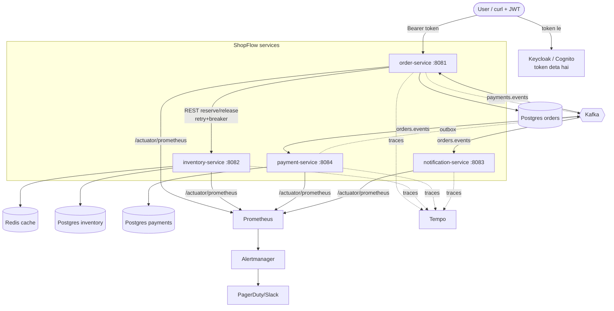

**Kya:** 4 Spring Boot services. Customer order-service ko call karta hai; wo inventory ko **synchronous** (REST) poochhta hai (kyunki customer jawab ka intezaar kar raha hai), aur payment/notification ko **asynchronous** (Kafka events) chalata hai.
**Kyu:** jo cheez turant chahiye (stock hai ya nahi) wo sync; jo baad mein ho sakti hai (charge karna, email) wo async — isse customer ka response fast rehta hai aur services loosely coupled.
**Kaise:** sync = `InventoryClient` (REST + Resilience4j). Async = **transactional outbox → Kafka → listeners**.
**Code kahan:** `order-service/.../order/OrderService.java`, `.../inventory/InventoryClient.java`.
**Related:** choreography vs orchestration, loose coupling, CAP (sync path = availability trade-off isliye breaker).

---

## 2. Order state machine

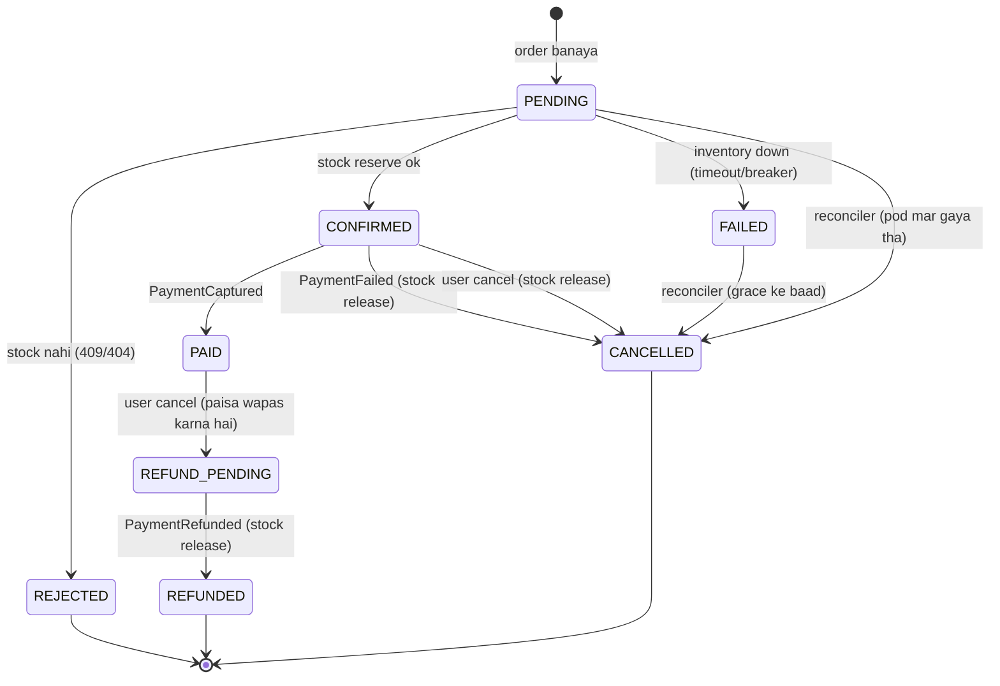

**Kya:** har order in states se guzarta hai.
**Kyu (sabse important rule):** jahan **paisa nahi chala** (PENDING, FAILED) → auto-cancel safe. Jahan **paisa chal sakta hai** (CONFIRMED, REFUND_PENDING) → auto-cancel **mat karo**, sirf gauge+alert (payment in-flight ho sakta hai). Galat guess = paid order strand ho jayega.
**Kaise:** transitions `Order.java` methods (`confirm/reject/fail/cancel/markPaid/requestRefund/markRefunded`); decisions `OrderService.java`.
**Code kahan:** `order-service/.../order/Order.java`, `OrderStatus.java`, `OrderService.java`.
**Related:** [#9 limbo/reconciler](#9-limbo), saga compensation, idempotency-by-state.

---

## 3. Create order flow

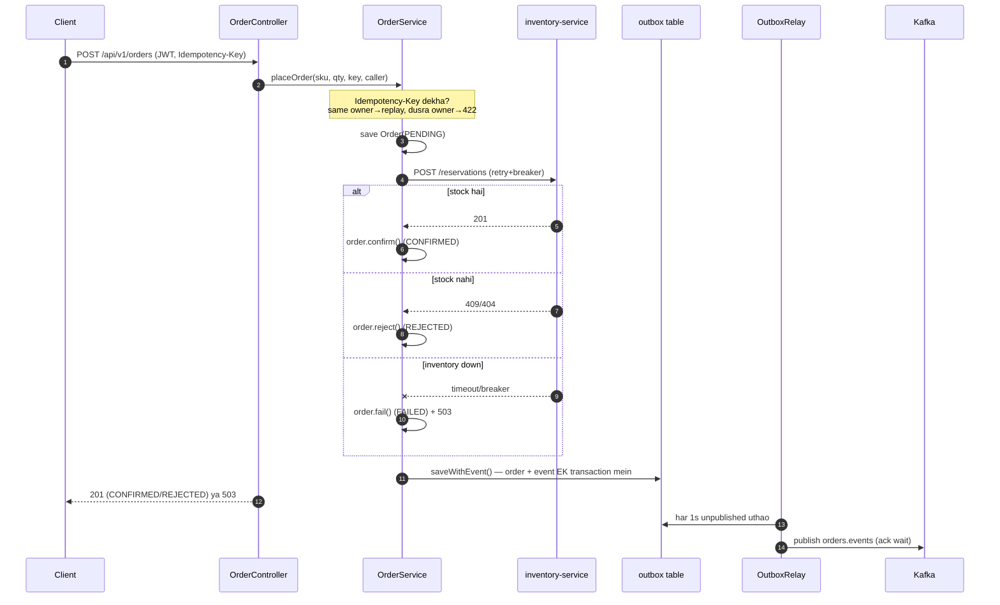

**Kya:** ek POST ka safar.
**Kyu:** `placeOrder` **ek bada @Transactional nahi** hai — HTTP call ke dauraan DB transaction/connection pakde rakhna pool kha jaata hai. Isliye har step alag save, aur status batata hai kitni door pahunche.
**Kaise:** step 10 (`saveWithEvent`) = order row + outbox row **ek hi chhoti local transaction** mein (`TransactionTemplate`, taaki self-call proxy bypass na ho).
**Code kahan:** `OrderController.create()`, `OrderService.placeOrder()` + `saveWithEvent()`.
**Related:** [#5 outbox](#5-outbox), [#7 idempotency](#7-idempotency), [#8 resilience](#8-resilience).

---

## 4. Saga

Choreography saga: koi central boss nahi, har service pichhle step ke event pe react karta hai.

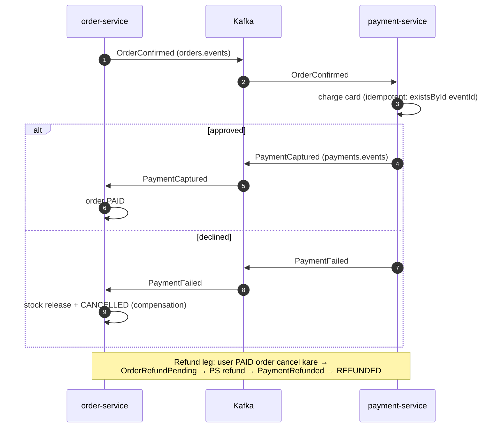

**Kya:** reserve ke baad charge karna, aur fail hone pe ulta karna (compensation).
**Kyu:** distributed transaction (2PC) mahanga/nazuk hai; saga = chhote local steps + compensation.
**Kaise:** events outbox se jaate hain; consumers idempotent. Refund = ulti saga (same machinery, opposite direction), idempotency **state se** (payment already REFUNDED → no-op).
**Code kahan:** `payment-service/.../OrderConfirmedListener.java`, `order-service/.../payment/PaymentEventListener.java`, `OrderService.onPayment*`.
**Related:** [#7 idempotency](#7-idempotency), [#2 state machine](#2-order-state-machine).

---

## 5. Outbox

**Dual-write problem:** DB save karo phir Kafka bhejo — agar beech mein crash? Ya DB commit hua Kafka nahi (ya ulta). Event lost ya phantom.

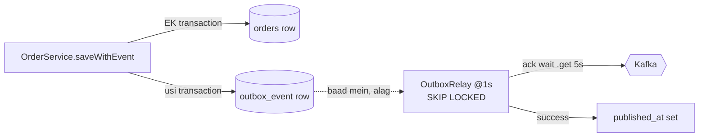

**Kya:** business change + "event bhejna hai" **ek hi DB transaction** mein likho; alag relay baad mein Kafka pe bhejta hai.
**Kyu:** ek hi DB transaction atomic hai → event kabhi lost nahi. Relay crash kare to row abhi bhi unpublished → agli baar bhej dega (**at-least-once** → consumers idempotent chahiye).
**Kaise:** `OutboxRelay.publishPending()` `SELECT ... FOR UPDATE SKIP LOCKED` se batch uthata hai (multi-pod safe), Kafka ack ka wait karta hai, phir `published_at` set. Purani rows nightly cleanup.
**Code kahan:** `shopflow-outbox/.../OutboxRelay.java`, `OutboxPublisher.java`, `OutboxRepository.java`.
**Related:** at-least-once, [#7 idempotency](#7-idempotency), CDC (Debezium) = doosra variant.

---

## 6. Oversell

Do customers, ek hi PS5, stock = 1. Dono ek saath aaye. Oversell NAHI hona chahiye.

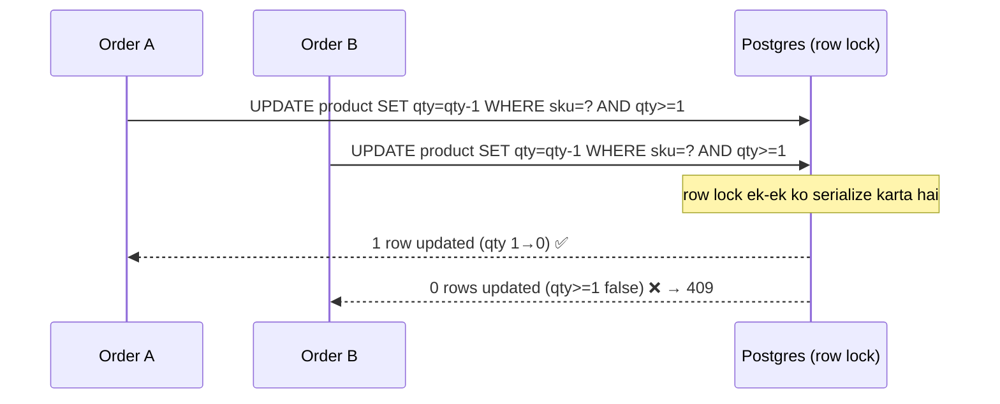

**Kya:** ek atomic `UPDATE ... WHERE quantity >= :qty`.
**Kyu:** "read then write" (pehle select, phir ghatao) race condition deta hai. Single atomic UPDATE mein DB ka **row lock** do concurrent ko serialize karta hai, aur `WHERE` dobara check karta hai → oversell impossible.
**Kaise:** `decrementStock` 0 rows return kare → stock nahi → 409. Race-loser (same orderRef, unique key) `DataIntegrityViolationException` pakad ke winner ki reservation laut deta hai.
**Code kahan:** `inventory-service/.../product/ProductRepository.decrementStock`, `reservation/ReservationService.java`, `ReservationController.java`.
**Related:** optimistic lock (`@Version` on Order), idempotency, DB isolation.

---

## 7. Idempotency

Same cheez do baar aaye to effect **ek hi baar**. Teen jagah, teen tareeke:

| Kahan | Kaise | Kyu yahi |
|---|---|---|
| POST /orders | client ka **Idempotency-Key** header (per-owner unique) | retried POST naya order na banaye; dusre user ka order replay na ho (422) |
| reserve | **orderRef** idempotency key (same orderRef → wahi reservation) | retry/duplicate reserve stock dobara na ghataaye |
| Kafka consumers | **processed_event** table (`existsById(eventId)`) + **state-guard** | at-least-once delivery → duplicate event = no-op |

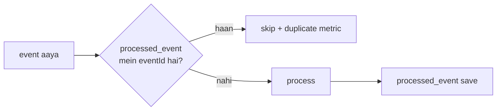

**Code kahan:** `OrderService.placeOrder` (key), `ReservationService.reserve` (orderRef), `notification/OrderEventListener`, `payment/PaymentEventListener`, `OrderConfirmedListener` (state-guard refund).
**Related:** at-least-once, outbox, saga.

---

## 8. Resilience

inventory-service slow/down ho to order-service ko bachao.

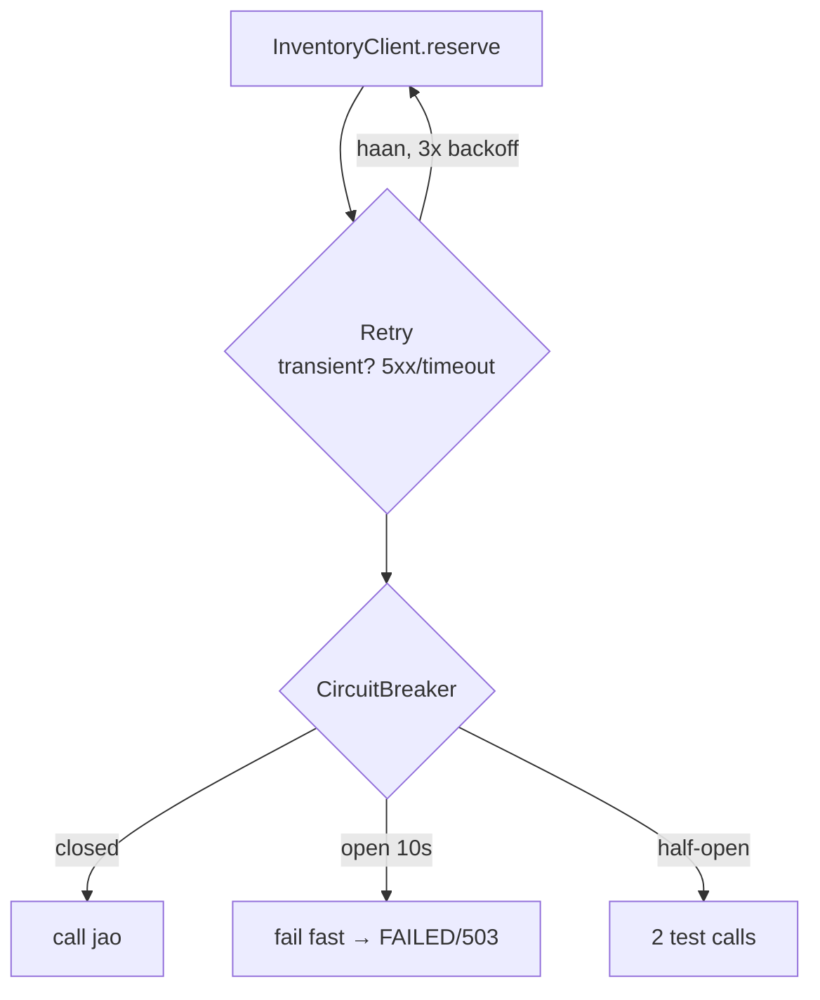

**Kya:** har call `Retry(CircuitBreaker(call))`.
**Kyu:** transient error pe retry; par agar inventory sach mein down hai to **breaker open** → fail fast (threads pile up nahi hote, cascading failure ruka).
**Kaise:** breaker: last 10 calls mein 50% fail → open 10s → half-open 2 test. Retry sirf `ResourceAccessException`/`HttpServerErrorException` pe (business 409/404 pe nahi). Breaker open → `InventoryCircuitOpen` alert.
**Code kahan:** `InventoryClient.java` + `application.yml` `resilience4j:`.
**Related:** timeout (connect 1s/read 2s), bulkhead, [#11 alerts](#11-observability).

---

## 9. Limbo

"Outcome unknown" orders ka owner kaun?

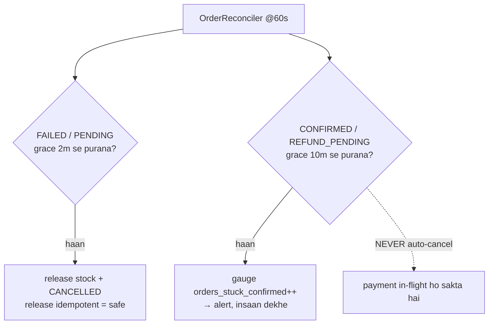

**Kya:** background job atke orders settle karta hai.
**Kyu:** FAILED/PENDING = paisa nahi chala → safe cancel. CONFIRMED/REFUND_PENDING = paisa chal sakta hai → **guess mat karo**, gauge + alert → human runbook follow kare.
**Kaise:** `reconcileFailedOrders` (release+cancel), `countStuckConfirmed` (gauge). Alert `OrdersStuckConfirmed`.
**Code kahan:** `OrderReconciler.java`, `OrderService.reconcileFailedOrders/countStuckConfirmed`.
**Related:** [#2 state machine](#2-order-state-machine), runbook `docs/runbooks/OrdersStuckConfirmed.md`.

---

## 10. Auth

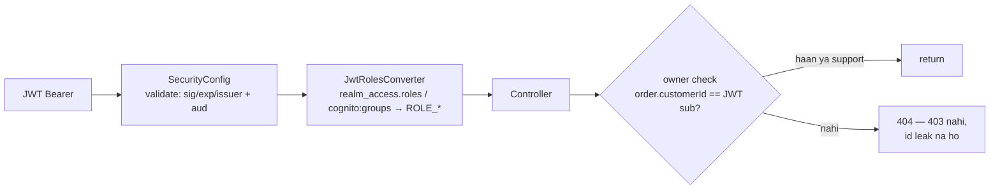

**Kya:** order-service OAuth2 **resource server** (sirf JWT verify, session nahi).
**Kyu:** authentication ≠ authorization. Sirf "role hai" kaafi nahi — **ownership** check (IDOR/BOLA rokna). Dusre ki id pe **404** (403 nahi) taaki id exist karti hai ye pata na chale.
**Kaise:** `SecurityConfig` validate; `Caller.mayAccess` owner/support check; audience validator token dusri API ke liye mint hua ho to reject.
**Code kahan:** `security/SecurityConfig.java`, `JwtDecoderConfig.java`, `JwtRolesConverter.java`, `order/Caller.java`.
**Related:** OWASP API#1 (BOLA), stateless auth, Keycloak↔Cognito portability.

---

## 11. Observability

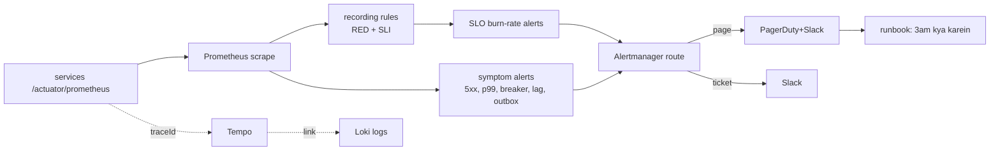

**Kya:** metrics → rules → alert → Alertmanager → page + runbook. Traces (Tempo) ↔ logs (Loki) linked.
**Kyu:** alert jo kisi tak na pahunche = dashboard. SLO (burn-rate) "bura hai ya nahi" ko opinion se **arithmetic** bana deta hai. Har alert ka runbook (3 baje sochne ka time nahi).
**Kaise:** `alert-rules.yml` (symptom) + `slo-rules.yml` (burn-rate) + `recording-rules.yml`, test `tests/alerts_test.yml`, route `alertmanager.yml`. **Yaad:** SLO ko `le=1.0` bucket chahiye → `application.yml` mein `distribution.slo: http.server.requests: 1s` (Walk 8 bug).
**Code kahan:** `shopflow/monitoring/`, `docs/runbooks/`.
**Related:** RED metrics, SLI/SLO/error-budget, [#8 breaker alert](#8-resilience).

---

## 12. Deploy

Ek hi cheez deploy karne ke basic → advanced tareeke (dono jaan-bujh ke rakhe hain):

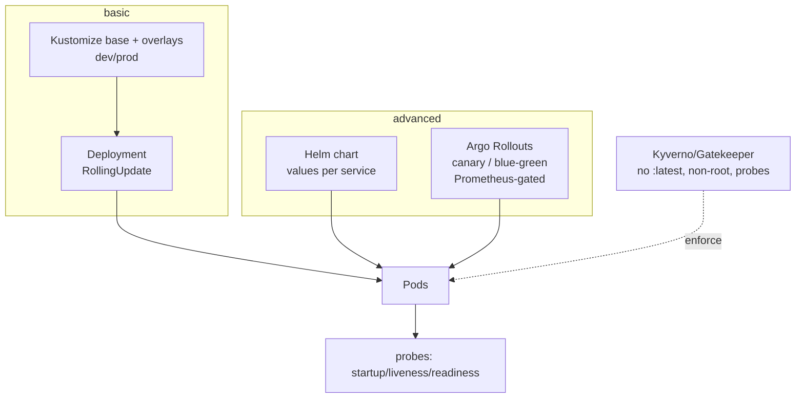

**Kya:** Kustomize (base+overlay), Helm (template+values), Argo Rollouts (progressive).
**Kyu:** RollingUpdate bad release 100% pods tak minute mein pahunchata hai → canary pehle thode traffic ko, Prometheus se check, phir aage. Probes: readiness sirf apni DB pe depend kare (inventory down → order pods LB se na hatein, warna ek outage do ban jaaye). **No `spec.replicas`** (HPA owns count).
**Kaise:** `k8s/base` + `overlays/{dev,prod}`, `helm/`, `k8s/rollouts/`, `k8s/policies/`.
**Code kahan:** `shopflow/k8s/`, `shopflow/helm/`.
**Related:** HPA/PDB/NetworkPolicy, distroless, IRSA (prod).

---

## 13. CI/CD

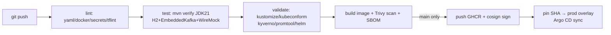

**Kya:** commit → lint → test → validate → build → scan → (main) push+sign → GitOps deploy.
**Kyu:** har gate ek tarah ka bug rokta hai. Supply chain: SBOM (andar kya hai) + cosign (sirf signed image chale, Kyverno verify).
**Kaise:** `.github/workflows/shopflow.yml` (master+main pe gating; push/sign/deploy sirf main-gated). Jenkins + Argo CD alternatives.
**Code kahan:** `.github/workflows/shopflow.yml`, `shopflow/Jenkinsfile`, `shopflow/argocd/`.
**Related:** GitOps, keyless signing (OIDC), [#11 observability](#11-observability) (deploy ke baad watch).

---

### Related docs
- Concept detail (Hinglish prose): [`EASY-NOTES.md`](EASY-NOTES.md)
- Topic-wise deep audit: [`comprehension/README.md`](comprehension/README.md)
- "Ye kyu hai" bug stories: [`SELF-WALK.md`](SELF-WALK.md)
- Shabd-matlab: [`GLOSSARY.md`](GLOSSARY.md)
- Interview rapid-fire: [`interview-notes/README.md`](interview-notes/README.md)
