# VISUAL FLOWS — har cheez ek diagram + kya/kyu/kaise (easy Hinglish)

> Ye doc **aankhon se samajhne** ke liye hai. Har section: **diagram → kya/kyu/kaise → code kahan → related concepts.** Jahan `file:line` likha hai wahi source of truth hai. Prose detail chahiye to [`EASY-NOTES.md`](EASY-NOTES.md), gehra audit [`comprehension/`](comprehension/README.md).
>
> Diagrams **mermaid** mein hain — GitHub inhe apne-aap render karta hai (VS Code mein "Markdown Preview Mermaid" extension se).

## Fehrist
1. [Big picture — poora system](#1-big-picture)
2. [Order ki zindagi — state machine](#2-order-state-machine)
3. [Order banane ka request flow (happy path)](#3-create-order-flow)
4. [Saga — payment, compensation, refund](#4-saga)
5. [Transactional outbox + relay](#5-outbox)
6. [Oversell kaise ruka — concurrency](#6-oversell)
7. [Idempotency teen tarah se](#7-idempotency)
8. [Resilience — retry + circuit breaker](#8-resilience)
9. [Limbo orders — reconciler + stuck gauge](#9-limbo)
10. [Auth + IDOR](#10-auth)
11. [Observability → alert → runbook](#11-observability)
12. [Deploy — Kustomize / Helm / Rollouts + probes](#12-deploy)
13. [CI/CD — commit se prod tak](#13-cicd)
14. [JPA `save()` — persist vs merge (chhupa SELECT)](#14-save-persist-merge)
15. [Poison pill → DLT → alert → replay](#15-poison-pill-dlt)
16. [Zero-trust network map (NetworkPolicies)](#16-zero-trust-network)

---

## 1. Big picture

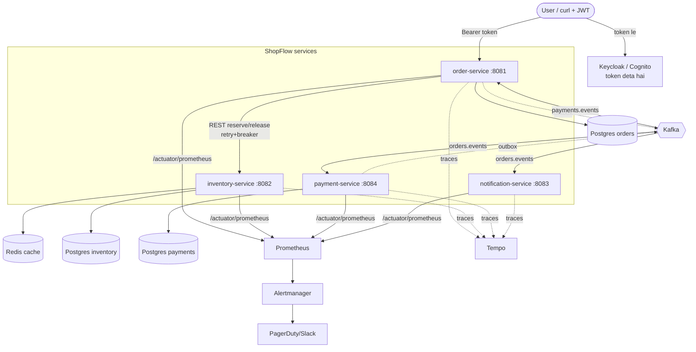

**Kya:** 4 Spring Boot services. Customer order-service ko call karta hai; wo inventory ko **synchronous** (REST) poochhta hai (kyunki customer jawab ka intezaar kar raha hai), aur payment/notification ko **asynchronous** (Kafka events) chalata hai.
**Kyu:** jo cheez turant chahiye (stock hai ya nahi) wo sync; jo baad mein ho sakti hai (charge karna, email) wo async — isse customer ka response fast rehta hai aur services loosely coupled.
**Kaise:** sync = `InventoryClient` (REST + Resilience4j). Async = **transactional outbox → Kafka → listeners**.
**Code kahan:** `order-service/.../order/OrderService.java`, `.../inventory/InventoryClient.java`.
**Related:** choreography vs orchestration, loose coupling, CAP (sync path = availability trade-off isliye breaker).

---

## 2. Order state machine

```mermaid
stateDiagram-v2
    [*] --> PENDING: order banaya
    PENDING --> CONFIRMED: stock reserve ok
    PENDING --> REJECTED: stock nahi (409/404)
    PENDING --> FAILED: inventory down (timeout/breaker)
    CONFIRMED --> PAID: PaymentCaptured
    CONFIRMED --> CANCELLED: PaymentFailed (stock release)
    CONFIRMED --> CANCELLED: user cancel (stock release)
    PAID --> REFUND_PENDING: user cancel (paisa wapas karna hai)
    REFUND_PENDING --> REFUNDED: PaymentRefunded (stock release)
    REFUND_PENDING --> REFUND_PENDING: PaymentRefundFailed (gateway declined → payment CAPTURED rehta, alert + retry; fake REFUNDED nahi — Walk 20)
    FAILED --> CANCELLED: reconciler (grace ke baad)
    PENDING --> CANCELLED: reconciler (pod mar gaya tha)
    REJECTED --> [*]
    REFUNDED --> [*]
    CANCELLED --> [*]
```

**Kya:** har order in states se guzarta hai.
**Kyu (sabse important rule):** jahan **paisa nahi chala** (PENDING, FAILED) → auto-cancel safe. Jahan **paisa chal sakta hai** (CONFIRMED, REFUND_PENDING) → auto-cancel **mat karo**, sirf gauge+alert (payment in-flight ho sakta hai). Galat guess = paid order strand ho jayega.
**Kaise:** transitions `Order.java` methods (`confirm/reject/fail/cancel/markPaid/requestRefund/markRefunded`); decisions `OrderService.java`.
**Code kahan:** `order-service/.../order/Order.java`, `OrderStatus.java`, `OrderService.java`.
**Related:** [#9 limbo/reconciler](#9-limbo), saga compensation, idempotency-by-state.

---

## 3. Create order flow

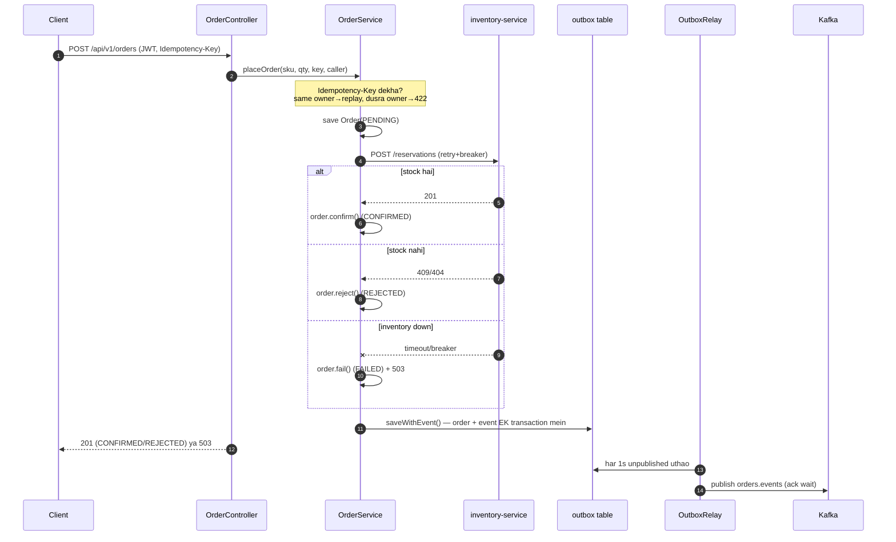

**Kya:** ek POST ka safar.
**Kyu:** `placeOrder` **ek bada @Transactional nahi** hai — HTTP call ke dauraan DB transaction/connection pakde rakhna pool kha jaata hai. Isliye har step alag save, aur status batata hai kitni door pahunche.
**Kaise:** step 10 (`saveWithEvent`) = order row + outbox row **ek hi chhoti local transaction** mein (`TransactionTemplate`, taaki self-call proxy bypass na ho).
**Code kahan:** `OrderController.create()`, `OrderService.placeOrder()` + `saveWithEvent()`.
**Related:** [#5 outbox](#5-outbox), [#7 idempotency](#7-idempotency), [#8 resilience](#8-resilience).

---

## 4. Saga

Choreography saga: koi central boss nahi, har service pichhle step ke event pe react karta hai.

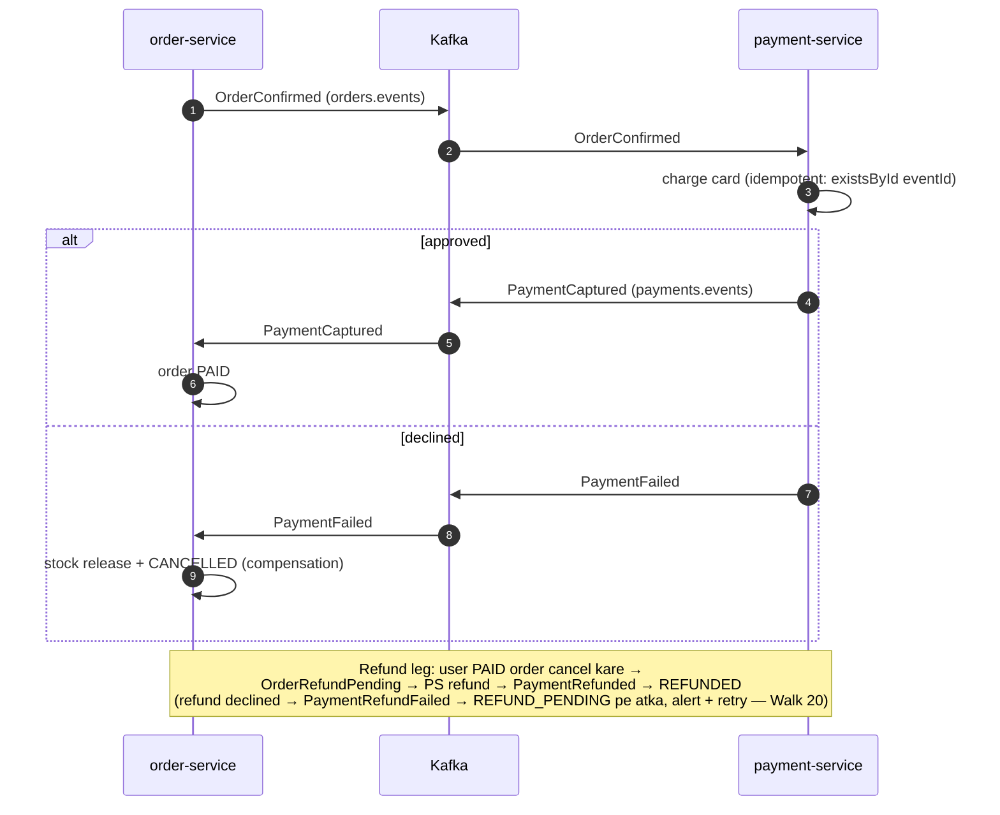

**Kya:** reserve ke baad charge karna, aur fail hone pe ulta karna (compensation).
**Kyu:** distributed transaction (2PC) mahanga/nazuk hai; saga = chhote local steps + compensation.
**Kaise:** events outbox se jaate hain; consumers idempotent. Refund = ulti saga (same machinery, opposite direction), idempotency **state se** (payment already REFUNDED → no-op; declined → CAPTURED hi rehta, redelivery retry karega — kabhi fake REFUNDED nahi).
**Code kahan:** `payment-service/.../OrderConfirmedListener.java`, `order-service/.../payment/PaymentEventListener.java`, `OrderService.onPayment*`.
**Related:** [#7 idempotency](#7-idempotency), [#2 state machine](#2-order-state-machine).

---

## 5. Outbox

**Dual-write problem:** DB save karo phir Kafka bhejo — agar beech mein crash? Ya DB commit hua Kafka nahi (ya ulta). Event lost ya phantom.

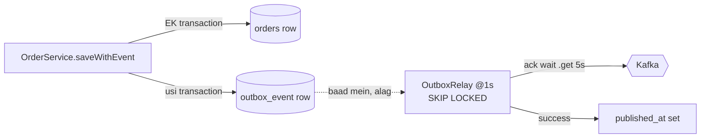

**Kya:** business change + "event bhejna hai" **ek hi DB transaction** mein likho; alag relay baad mein Kafka pe bhejta hai.
**Kyu:** ek hi DB transaction atomic hai → event kabhi lost nahi. Relay crash kare to row abhi bhi unpublished → agli baar bhej dega (**at-least-once** → consumers idempotent chahiye).
**Kaise:** `OutboxRelay.publishPending()` `SELECT ... FOR UPDATE SKIP LOCKED` se batch uthata hai (multi-pod safe), Kafka ack ka wait karta hai, phir `published_at` set. Purani rows nightly cleanup.
**Code kahan:** `shopflow-outbox/.../OutboxRelay.java`, `OutboxPublisher.java`, `OutboxRepository.java`.
**Related:** at-least-once, [#7 idempotency](#7-idempotency), CDC (Debezium) = doosra variant.

---

## 6. Oversell

Do customers, ek hi PS5, stock = 1. Dono ek saath aaye. Oversell NAHI hona chahiye.

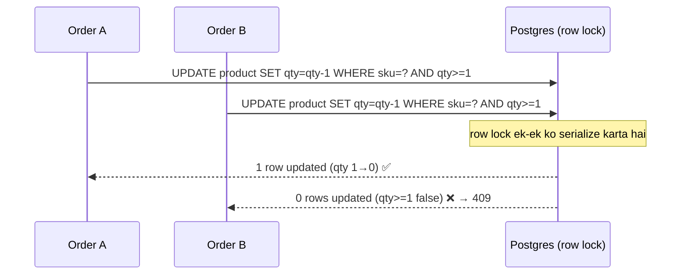

**Kya:** ek atomic `UPDATE ... WHERE quantity >= :qty`.
**Kyu:** "read then write" (pehle select, phir ghatao) race condition deta hai. Single atomic UPDATE mein DB ka **row lock** do concurrent ko serialize karta hai, aur `WHERE` dobara check karta hai → oversell impossible.
**Kaise:** `decrementStock` 0 rows return kare → stock nahi → 409. Race-loser (same orderRef, unique key) `DataIntegrityViolationException` pakad ke winner ki reservation laut deta hai.
**Code kahan:** `inventory-service/.../product/ProductRepository.decrementStock`, `reservation/ReservationService.java`, `ReservationController.java`.
**Related:** optimistic lock (`@Version` on Order), idempotency, DB isolation.

---

## 7. Idempotency

Same cheez do baar aaye to effect **ek hi baar**. Teen jagah, teen tareeke:

| Kahan | Kaise | Kyu yahi |
|---|---|---|
| POST /orders | client ka **Idempotency-Key** header (per-owner unique) | retried POST naya order na banaye; dusre user ka order replay na ho (422) |
| reserve | **orderRef** idempotency key (same orderRef → wahi reservation) | retry/duplicate reserve stock dobara na ghataaye |
| Kafka consumers | **processed_event** table (`existsById(eventId)`) + **state-guard** | at-least-once delivery → duplicate event = no-op |

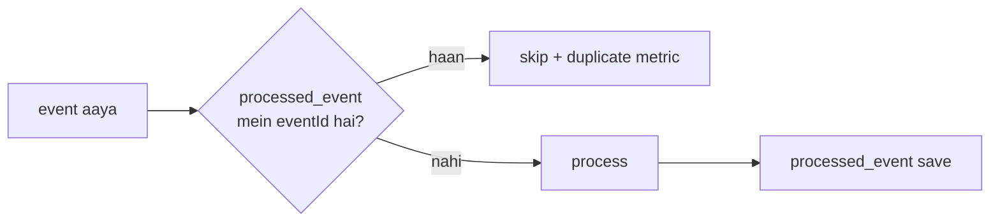

**Code kahan:** `OrderService.placeOrder` (key), `ReservationService.reserve` (orderRef), `notification/OrderEventListener`, `payment/PaymentEventListener`, `OrderConfirmedListener` (state-guard refund).
**Related:** at-least-once, outbox, saga.

---

## 8. Resilience

inventory-service slow/down ho to order-service ko bachao.

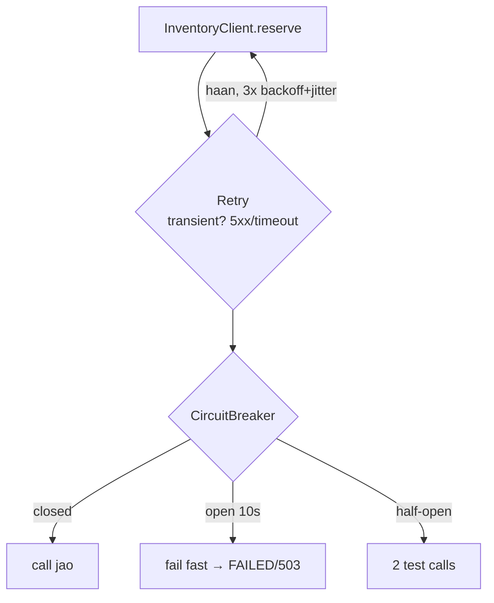

**Kya:** har call `Retry(CircuitBreaker(call))`.
**Kyu:** transient error pe retry; par agar inventory sach mein down hai to **breaker open** → fail fast (threads pile up nahi hote, cascading failure ruka).
**Kaise:** breaker: last 10 calls mein 50% fail → open 10s → half-open 2 test. Retry sirf `ResourceAccessException`/`HttpServerErrorException` pe (business 409/404 pe nahi), backoff 200ms→400ms **+ jitter ±50%** (pods lockstep mein retry na karein). Breaker open → `InventoryCircuitOpen` alert.
**Code kahan:** `InventoryClient.java` + `application.yml` `resilience4j:`.
**Related:** timeout (connect 1s/read 2s), bulkhead, [#11 alerts](#11-observability).

---

## 9. Limbo

"Outcome unknown" orders ka owner kaun?

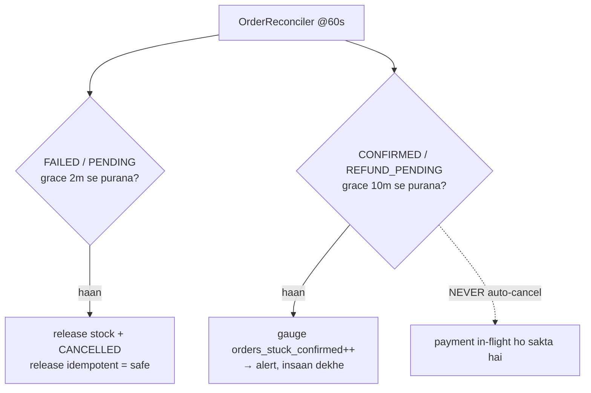

**Kya:** background job atke orders settle karta hai.
**Kyu:** FAILED/PENDING = paisa nahi chala → safe cancel. CONFIRMED/REFUND_PENDING = paisa chal sakta hai → **guess mat karo**, gauge + alert → human runbook follow kare.
**Kaise:** `reconcileFailedOrders` (release+cancel), `countStuckConfirmed` (gauge). Alert `OrdersStuckConfirmed`.
**Code kahan:** `OrderReconciler.java`, `OrderService.reconcileFailedOrders/countStuckConfirmed`.
**Related:** [#2 state machine](#2-order-state-machine), runbook `docs/runbooks/OrdersStuckConfirmed.md`.

---

## 10. Auth

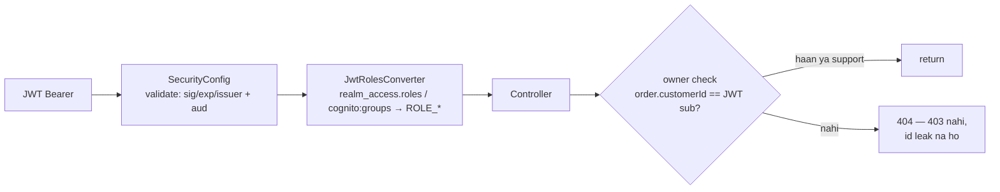

**Kya:** order-service OAuth2 **resource server** (sirf JWT verify, session nahi).
**Kyu:** authentication ≠ authorization. Sirf "role hai" kaafi nahi — **ownership** check (IDOR/BOLA rokna). Dusre ki id pe **404** (403 nahi) taaki id exist karti hai ye pata na chale.
**Kaise:** `SecurityConfig` validate; `Caller.mayAccess` owner/support check; audience validator token dusri API ke liye mint hua ho to reject.
**Code kahan:** `security/SecurityConfig.java`, `JwtDecoderConfig.java`, `JwtRolesConverter.java`, `order/Caller.java`.
**Related:** OWASP API#1 (BOLA), stateless auth, Keycloak↔Cognito portability.

---

## 11. Observability

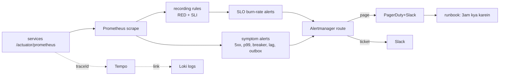

**Kya:** metrics → rules → alert → Alertmanager → page + runbook. Traces (Tempo) ↔ logs (Loki) linked.
**Kyu:** alert jo kisi tak na pahunche = dashboard. SLO (burn-rate) "bura hai ya nahi" ko opinion se **arithmetic** bana deta hai. Har alert ka runbook (3 baje sochne ka time nahi).
**Kaise:** `alert-rules.yml` (symptom) + `slo-rules.yml` (burn-rate) + `recording-rules.yml`, test `tests/alerts_test.yml`, route `alertmanager.yml`. **Yaad:** SLO ko `le=1.0` bucket chahiye → `application.yml` mein `distribution.slo: http.server.requests: 1s` (Walk 8 bug).
**Code kahan:** `shopflow/monitoring/`, `docs/runbooks/`.
**Related:** RED metrics, SLI/SLO/error-budget, [#8 breaker alert](#8-resilience).

---

## 12. Deploy

Ek hi cheez deploy karne ke basic → advanced tareeke (dono jaan-bujh ke rakhe hain):

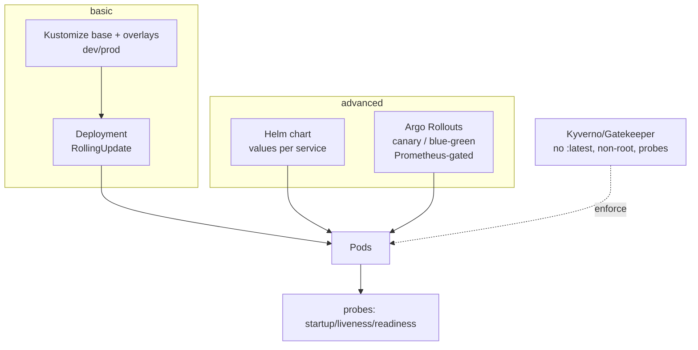

**Kya:** Kustomize (base+overlay), Helm (template+values), Argo Rollouts (progressive).
**Kyu:** RollingUpdate bad release 100% pods tak minute mein pahunchata hai → canary pehle thode traffic ko, Prometheus se check, phir aage. Probes: readiness sirf apni DB pe depend kare (inventory down → order pods LB se na hatein, warna ek outage do ban jaaye). **No `spec.replicas`** (HPA owns count).
**Kaise:** `k8s/base` + `overlays/{dev,prod}`, `helm/`, `k8s/rollouts/`, `k8s/policies/`.
**Code kahan:** `shopflow/k8s/`, `shopflow/helm/`.
**Related:** HPA/PDB/NetworkPolicy, distroless, IRSA (prod).

---

## 13. CI/CD

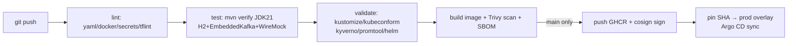

**Kya:** commit → lint → test → validate → build → scan → (main) push+sign → GitOps deploy.
**Kyu:** har gate ek tarah ka bug rokta hai. Supply chain: SBOM (andar kya hai) + cosign (sirf signed image chale, Kyverno verify).
**Kaise:** `.github/workflows/shopflow.yml` (master+main pe gating; push/sign/deploy sirf main-gated). Jenkins + Argo CD alternatives.
**Code kahan:** `.github/workflows/shopflow.yml`, `shopflow/Jenkinsfile`, `shopflow/argocd/`.
**Related:** GitOps, keyless signing (OIDC), [#11 observability](#11-observability) (deploy ke baad watch).

---

## 14. JPA `save()` — persist vs merge (chhupa SELECT) <a id="14-save-persist-merge"></a>

**Decision Spring Data har `save()` pe leta hai** (`SimpleJpaRepository.save`):

```
                    repo.save(entity)
                          │
                 entityInformation.isNew(entity)?
                          │
            ┌─────────────┴──────────────┐
          TRUE                          FALSE
            │                             │
      em.persist(e)                 em.merge(e)
            │                             │
      ┌─────────┐              ┌──────────────────────┐
      │ INSERT  │              │ SELECT ... WHERE id=? │  ← round-trip
      └─────────┘              │   mila?  → UPDATE     │
     1 query                   │   nahi? → INSERT      │
                               └──────────────────────┘
                                   2 queries
```

**Default `isNew()` kaise sochta hai** (no custom):
```
   @Version field hai?  ──yes──►  version == null  → NEW
          │ no
   @Id null hai?        ──yes──►  NEW      (persist → INSERT)
          │ no (id set hai)
          └──────────────────►  "purana"  (merge → SELECT+...)
```

**Humara trap:** `eventId` / UUID hum **khud** set karte hain → id kabhi null nahi → default bolta hai "purana" → **merge → bekaar SELECT**, har Kafka message pe, consumer txn ke andar.

**Fix — `Persistable` se khud bata do insert-only hai:**
```
  class Payment implements Persistable<UUID> {
      getId()  → eventId
      isNew()  → true        // ye table sirf INSERT hoti hai
  }
            │
            ▼
      isNew()==true  →  persist()  →  pure INSERT   (SELECT gaya)
```

**Kaun-kaun (humare 7 entities):**
```
  assigned @Id (hum dete)        generated @Id (DB deta, IDENTITY)
  ────────────────────────       ─────────────────────────────────
  OutboxEvent      (W21) ✅       Product      → default sahi (id null→persist)
  ProcessedEvent×2 (W38) ✅       Reservation  → default sahi
  Payment          (W38) ✅       Order        → @Version + sach-much UPDATE
                                                 hoti → merge SAHI hai, rehne do
  → in sabko Persistable
```

**Kya:** assigned id + insert-only entity pe `Persistable isNew()==true` → `save()` = plain INSERT, merge ka SELECT nahi.
**Kyu:** wo SELECT round-trip saga ke hot path pe bekaar hai; row hum jaante hain nayi hai.
**Safe kyu:** ye rows `save()` se kabhi update nahi hoti (Payment refund `markRefunded()` dirty-check se, `save()` nahi); idempotency guard **PK** hai (duplicate eventId INSERT pe fail), merge ke SELECT pe kabhi depend nahi tha.
**Jaal (interview):** "`isNew(){return true}` jhooth hai na?" — nahi, kyunki insert-only; agar kabhi update-via-save aaya to `isNew` ko `createdAt==null` banana padega.
**Code kahan:** `shopflow-outbox/.../OutboxEvent.java`, `*/ProcessedEvent.java`, `payment-service/.../Payment.java`.
**Related:** [#7 idempotency](#7-idempotency) (PK hi guard), [#5 outbox](#5-outbox) (OutboxEvent wahi pattern), `SELF-WALK.md` Walk 21 + 38.

---

## 15. Poison pill → DLT → alert → replay <a id="15-poison-pill-dlt"></a>

Ek kharab message poori partition na roke, aur DLT pe jaake **chup bhi na ho jaaye**.

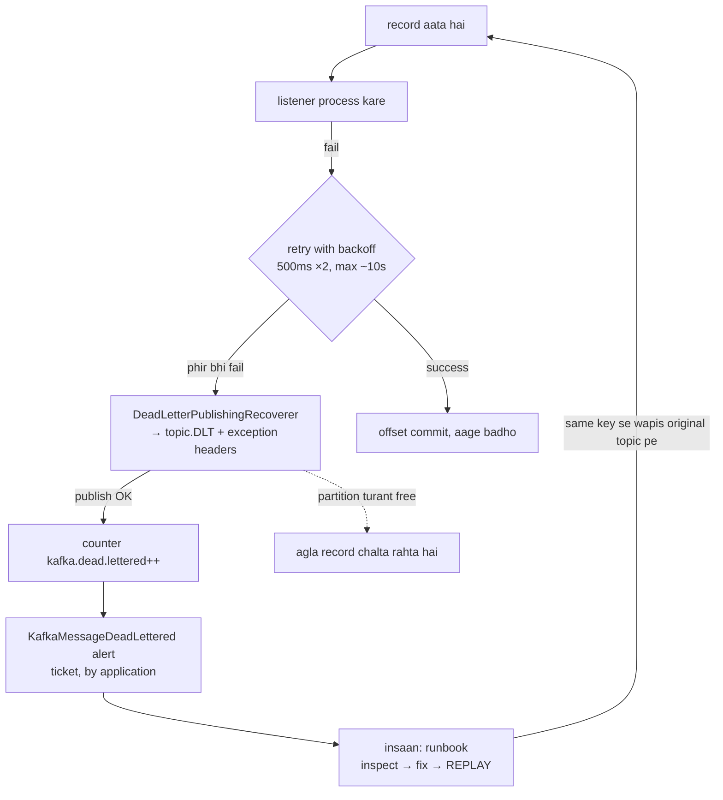

**Kya:** fail hota record backoff se retry hota hai; nahi sudhra to `.DLT` pe park + **counter** + **ticket**; insaan fix karke replay karta hai.
**Kyu (do failure modes, dono cover):** (1) DLT na ho → ek poison pill **poori partition block** (uske peeche ke saare orders atke). (2) DLT ho par alert na ho → event **chupchaap lost** (email nahi gayi, payment outcome apply nahi hua) — Walk 40 se pehle yahi tha. DLT bina alert ke **graveyard hai, parking lot nahi**.
**Replay safe kyu:** har consumer idempotent (`processed_event`/PK dedupe) → duplicate replay harmless. Same key (orderRef) se produce karo taaki same partition pe jaaye (ordering).
**Counter kab badhta:** sirf DLT publish **succeed** hone ke baad (`accept()` ke baad increment) — "humne try kiya" nahi, "safely parked" ka matlab.
**Code kahan:** teeno services ka `KafkaErrorConfig.java`; alert `monitoring/alert-rules.yml`; runbook `docs/runbooks/KafkaMessageDeadLettered.md`; dashboard panel 12.
**Related:** [#7 idempotency](#7-idempotency) (replay isi pe tikta hai), [#11 observability](#11-observability), `SELF-WALK.md` Walk 40–41.

---

## 16. Zero-trust network map (NetworkPolicies) <a id="16-zero-trust-network"></a>

Default **sab band** (ingress + egress deny), phir sirf zaroori raste khule. Har teer = ek explicit allow-rule (`k8s/base/network-policies.yaml`); jo teer nahi hai, wo connection **ho hi nahi sakta**.

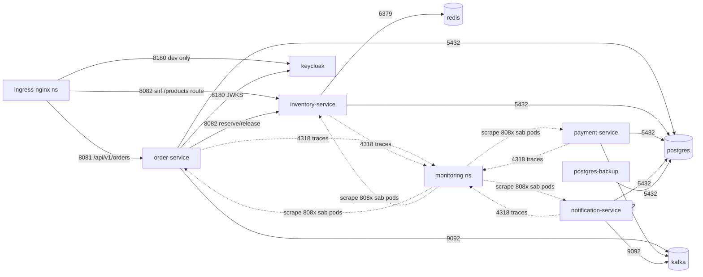

**Kya:** namespace ke andar zero-trust — `default-deny-ingress` + `default-deny-egress-allow-dns` (DNS sabko, kube-dns:53), phir per-pod allow.
**Kyu:** compromised pod blast-radius chhota — payment-service ka pod hack ho to wo inventory ko chhu bhi nahi sakta (uske egress mein inventory hai hi nahi), internet pe kuch exfiltrate nahi kar sakta (egress deny).
**Padhne ka tareeka (symmetry rule):** har connection ke **do** rules chahiye — caller ke egress mein target, target ke ingress mein caller. Ek bhi missing = connection blocked. Isliye audit dono taraf se karo.
**Dhyaan:** (1) inventory ka reservations API app-level pe unauthenticated hai — guard = ye policies + "Ingress sirf `/products` route karta hai"; L3/L4 hai, identity nahi — next step mTLS/client-credentials (ROADMAP, documented trade-off). (2) Enforcement CNI pe depend karta hai (Calico/Cilium) — bina NetworkPolicy-supporting CNI ke ye YAML **silent no-op** hai. (3) inventory Kafka se jaan-bujh ke disconnected (REST-only service).
**Code kahan:** `shopflow/k8s/base/network-policies.yaml` (prod overlay include karta hai).
**Related:** [#1 big picture](#1-big-picture), [#10 auth](#10-auth) (edge JWT), `interview-notes/11` (mesh/mTLS next step).

---

## 17. Double-release race: read-guard vs atomic transition (Walk 55) <a id="17-double-release-race"></a>

Do concurrent releases (reconciler pod A + customer cancel, ya pod A + pod B — HPA min-2!). `Reservation` pe `@Version` **nahi** hai.

**Pehle (bug):** guard = plain read → dono paas ho jaate hain:

```mermaid
sequenceDiagram
    participant A as release() — pod A
    participant DB as Postgres
    participant B as release() — pod B
    A->>DB: SELECT status (orderRef)  → RESERVED
    B->>DB: SELECT status (orderRef)  → RESERVED  (A ne commit nahi kiya)
    A->>DB: UPDATE status=RELEASED; stock = stock + 3
    A->>DB: COMMIT ✓
    B->>DB: UPDATE status=RELEASED (last-writer-wins, koi error NahI); stock = stock + 3
    B->>DB: COMMIT ✓  ← stock +6 for a 3-unit order = PHANTOM STOCK
```

**Ab (fix):** guard = conditional UPDATE — DB ka row lock serialise karta hai, WHERE dobara evaluate hota hai:

```mermaid
sequenceDiagram
    participant A as release() — pod A
    participant DB as Postgres
    participant B as release() — pod B
    A->>DB: UPDATE ... SET status=RELEASED WHERE orderRef=? AND status=RESERVED → 1 row
    B->>DB: UPDATE ... (same)  — row lock pe WAIT
    A->>DB: stock = stock + 3; COMMIT ✓
    DB-->>B: lock mila, WHERE re-check: status ab RELEASED → 0 rows
    B->>B: 0 rows → increment SKIP, log "released concurrently" ✓
```

**Kya:** `ReservationRepository.transition(orderRef, RESERVED, RELEASED)` — jisko `1` mila sirf wahi `incrementStock` karta hai.
**Kyu ye pattern:** `@Version` alternative tha, par wo schema change + loser ko exception (HTTP 500 → order-service ise "inventory down" samajhta, Walk 53 doosre end pe repeat). Conditional UPDATE wahi hai jo `decrementStock` oversell ke liye pehle se karta hai — ek hi service mein ek hi problem ka ek hi jawab.
**Test:** `concurrentReleasesRestoreStockOnlyOnce` (CyclicBarrier, 2 threads).
**Code kahan:** `inventory-service/.../ReservationService.release`, `ReservationRepository.transition`.
**Related:** [#14 save persist-vs-merge](#14-save-persist-merge) (JPA internals), EASY-NOTES §1 (atomic update), §2a (replay vs race).

---

### Related docs
- Concept detail (Hinglish prose): [`EASY-NOTES.md`](EASY-NOTES.md)
- Topic-wise deep audit: [`comprehension/README.md`](comprehension/README.md)
- "Ye kyu hai" bug stories: [`SELF-WALK.md`](SELF-WALK.md)
- Shabd-matlab: [`GLOSSARY.md`](GLOSSARY.md)
- Interview rapid-fire: [`interview-notes/README.md`](interview-notes/README.md)
